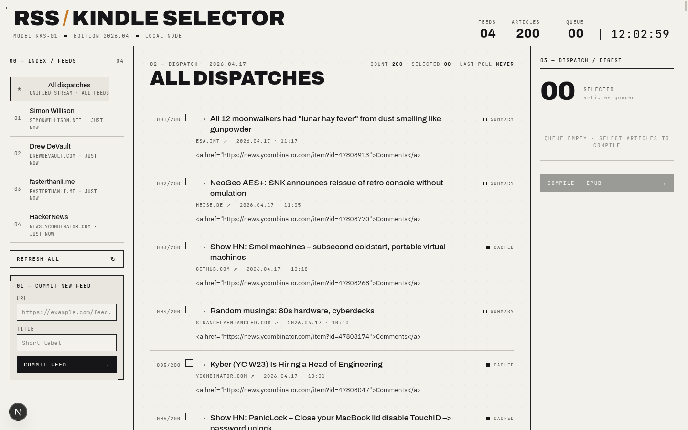

# rss-kindle-selector

[](https://github.com/JonahZander/rss_kindle_selector/actions/workflows/ci.yml)
[](LICENSE)

**The self-hosted news desk for your e-reader.** Subscribe to RSS feeds, hand-pick
the articles worth your attention, and press them into a clean, typographically
careful EPUB edition — emailed to a Kindle, pulled over OPDS by everything else.

> Pick your news. Press an edition. Read it anywhere.



## Why this exists

Every self-hosted RSS-to-ereader tool auto-sends whole feeds. Every
hand-pick-your-articles tool is paid SaaS — and the free options died in
2024–2025 (Pocket, Omnivore, Instapaper's free Kindle tier). The combination
*self-hosted* × *you choose each article* simply didn't exist. This fills that
gap. See [the landscape analysis](docs/landscape-and-options.md) for the full
"why not KindleEar / KTool / Calibre?" answer.

## Features

- **Curation is the product.** A triage UI built for skimming: expand an
  article inline (readable full text via [trafilatura](https://github.com/adbar/trafilatura)),
  tick the ones you want. Nothing is sent that you didn't pick.
- **Editions, not streams.** Output is a finite, dated EPUB issue with a cover,
  a sectioned table of contents, per-article bylines and reading times — the
  feeling of a newspaper, not a feed.
- **Any reader.** EPUB only. Kindle gets it by send-to-Kindle email; KOReader,
  Kobo, Boox, PocketBook and Xteink/CrossPoint pull it from the built-in OPDS
  catalog; everyone can just download the file.
- **Always fresh.** Background polling with conditional GET, per-feed health
  badges and backoff, optional retention cleanup — plus an optional "press
  deadline" that compiles and delivers your queue on a schedule.
- **No landlords.** One process, one SQLite file, your own SMTP account if you
  want email. `docker compose up` and it's yours.

## Quickstart (development)

Requirements: Node 20.19.6, [uv](https://docs.astral.sh/uv/), Python 3.12+.

```bash
git clone https://github.com/JonahZander/rss_kindle_selector.git
cd rss_kindle_selector
npm install

# terminal 1 — API on :8765
npm run dev:api

# terminal 2 — web on :3737
npm run dev:web
```

Open <http://localhost:3737>, add a feed (or import
[`example-feeds.opml`](example-feeds.opml)), hit *Refresh all*, pick articles,
*Compile · EPUB*.

A single-container `docker compose up` deployment ships with 1.0 — see the
[release spec](docs/superpowers/specs/2026-06-11-rss-kindle-selector-v2-design.md).

## Delivery

| Channel | Devices | How |
|---|---|---|
| **Download** | everything | Button on each ready edition |
| **OPDS catalog** | KOReader (incl. jailbroken Kindles), Kobo, Boox, Xteink/CrossPoint, Calibre | Point the reader at `http://<host>:8765/opds` |
| **Send-to-Kindle email** | Kindle, PocketBook | Configure SMTP in Settings; approve the sender in Amazon's Personal Document Settings (the in-app wizard walks you through it) |

## Configuration

| Env var | Default | Meaning |
|---|---|---|
| `DB_PATH` | `services/api/data/rss_kindle.db` | SQLite database file |
| `EPUB_DIR` | `services/api/data/epubs` | Where generated editions are stored |

Everything else (SMTP, OPDS auth, polling, retention, press deadline) lives in
the in-app **Settings** page.

## Architecture

FastAPI + SQLite (aiosqlite) with `PRAGMA user_version` migrations; feed
polling via feedparser with conditional GET; readable-content extraction via
trafilatura sanitized through nh3; EPUBs built with ebooklib; an in-process
asyncio scheduler (no Redis, no Celery, no cron). The Next.js front end is a
fully client-side app that ships as a static export served by the API in
production. Threat model: single user on localhost or a trusted LAN — put a
reverse proxy with basic auth in front if you expose it.

## Contributing

See [CONTRIBUTING.md](CONTRIBUTING.md). The active roadmap is the
[1.0 release spec](docs/superpowers/specs/2026-06-11-rss-kindle-selector-v2-design.md).

## License

[MIT](LICENSE) © Jonah Zander
