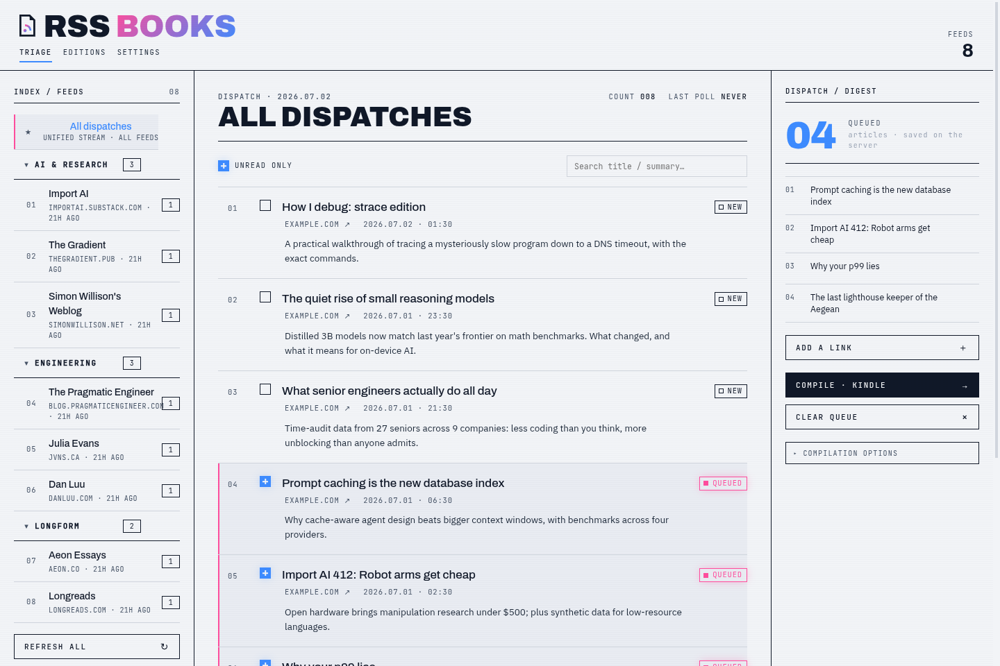

# rss-kindle-selector

[](https://github.com/JonahZander/rss_kindle_selector/actions/workflows/ci.yml)
[](LICENSE)

**The self-hosted news desk for your e-reader.** Subscribe to RSS feeds, hand-pick
the articles worth your attention, and press them into a clean, typographically
careful EPUB edition — emailed to a Kindle, pulled over OPDS by everything else.

> Pick your news. Press an edition. Read it anywhere.



## Why this exists

Every self-hosted RSS-to-ereader tool auto-sends whole feeds. Every
hand-pick-your-articles tool is paid SaaS — and the free options died in
2024–2025 (Pocket, Omnivore, Instapaper's free Kindle tier). The combination
*self-hosted* × *you choose each article* simply didn't exist. This fills that
gap. The full "why not KindleEar / KTool / Calibre?" answer lives in
[the landscape analysis](docs/landscape-and-options.md).

## Features

- **Curation is the product.** A triage desk built for skimming: expand an
  article inline (readable full text via trafilatura), tick the ones you want.
  The queue lives server-side — triage on your phone, compile at your desk.
  Nothing is ever sent that you didn't pick.
- **Editions, not streams.** Output is a finite, dated EPUB issue with a
  cover, a table of contents sectioned by source, bylines, reading times,
  embedded images (downscaled for e-ink), real tables and code blocks, and a
  stylesheet tuned for 6–7″ greyscale screens.
- **Any reader.** Kindle gets editions by send-to-Kindle email (with an
  in-app setup wizard). KOReader — including jailbroken Kindles —
  Xteink/CrossPoint, Kobo, Boox and Calibre pull them from the built-in OPDS
  catalog. Everyone can just download the file.
- **Always fresh.** Background polling with conditional GET and polite
  backoff; failing feeds get a badge, not a silent grave. An optional **press
  deadline** compiles your queue into an edition on a schedule — the
  Friday-paper ritual, but you still picked every article.
- **No landlords.** One process, one SQLite file, your own SMTP account if
  you want email. MIT licensed.

## Quickstart

```bash
git clone https://github.com/JonahZander/rss_kindle_selector.git
cd rss_kindle_selector
docker compose up -d
```

Open <http://localhost:8765>, import
[`example-feeds.opml`](example-feeds.opml) (sidebar → *Import OPML*) or add a
feed by URL, hit *Refresh all*, tick a few articles, *Compile · EPUB*.

Your database and editions live on the `rss_kindle_data` volume and survive
rebuilds.

### Development mode

Requirements: Node 20.19.6, [uv](https://docs.astral.sh/uv/), Python 3.12+.

```bash
npm install
npm run dev:api   # FastAPI on :8765
npm run dev:web   # Next.js on :3737 (proxies /api to :8765 — no CORS)
```

## Getting editions onto your reader

| Channel | Devices | Setup |
|---|---|---|
| **Download** | everything | Button on each ready edition |
| **OPDS catalog** | KOReader (incl. jailbroken Kindles), Xteink/CrossPoint, Kobo, Boox, Calibre | Add `http://<host>:8765/opds` as an OPDS catalog in the reader. Optional Basic auth in Settings. |
| **Send-to-Kindle email** | Kindle, PocketBook | Settings → Delivery: enter SMTP details, add your `@kindle.com` address, approve the From sender in Amazon's Personal Document Settings (the wizard links straight there), send the test email. |

Tip: with *email every edition* and a press deadline enabled, the morning
paper writes itself — from articles you picked the evening before.

## Configuration

Everything user-facing lives in the in-app **Settings** page (SMTP, OPDS auth,
polling, press deadline, retention, reading preferences). Environment
variables for operators:

| Env var | Default | Meaning |
|---|---|---|
| `DB_PATH` | `./data/rss_kindle.db` (`/data/...` in Docker) | SQLite database file |
| `EPUB_DIR` | `./data/epubs` (`/data/epubs` in Docker) | Where editions are stored |
| `STATIC_DIR` | unset (`/app/static` in Docker) | Static web app to serve same-origin |
| `SCHEDULER_ENABLED` | `1` | Set `0` to disable background polling entirely |
| `SMTP_HOST` / `SMTP_PORT` / `SMTP_USERNAME` / `SMTP_PASSWORD` / `SMTP_FROM` | unset | Override stored SMTP settings (keep credentials out of the DB) |

## Security posture

Single-user app for localhost or a trusted LAN/tailnet. There is deliberately
no login screen — don't expose it to the internet unauthenticated. If you need
remote access, put a reverse proxy with Basic auth in front (or use a VPN /
Tailscale). The OPDS catalog has its own optional Basic auth, since readers
hit it from other devices. Feed URLs are fetched server-side; keep that in
mind before adding feeds you don't trust.

## Architecture

One FastAPI process: API + in-process asyncio scheduler + background EPUB
builds. SQLite via aiosqlite with `PRAGMA user_version` migrations. Feed
parsing with feedparser (conditional GET, backoff); readable-content
extraction with trafilatura 2.x sanitized through an nh3 allowlist; EPUBs
built with ebooklib; covers with Pillow; email with aiosmtplib. The Next.js
front end is fully client-side and ships as a static export served by the API
— one container, no CORS. No Redis, no Celery, no cron.

```
feeds → poller (etag/backoff) → articles → [you pick] → queue
  → digest service → extract/sanitize → images (≤1200px) → EPUB (cover/TOC/css)
  → download · OPDS catalog · SMTP → your reader
```

## How it compares

See [docs/landscape-and-options.md](docs/landscape-and-options.md) for the
full market analysis (KindleEar, Calibre, KTool, Push to Kindle, Reabble,
EpubPress, …) and the
[research catalog](docs/research/2026-06-11-rss-to-ereader-services.md)
behind it.

## Contributing

See [CONTRIBUTING.md](CONTRIBUTING.md) and the
[design language](docs/design-language.md). The roadmap is the
[1.0 release spec](docs/superpowers/specs/2026-06-11-rss-kindle-selector-v2-design.md);
changes are tracked in the [CHANGELOG](CHANGELOG.md).

## License

[MIT](LICENSE) © Jonah Zander
